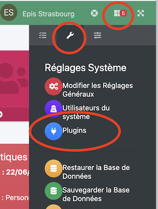
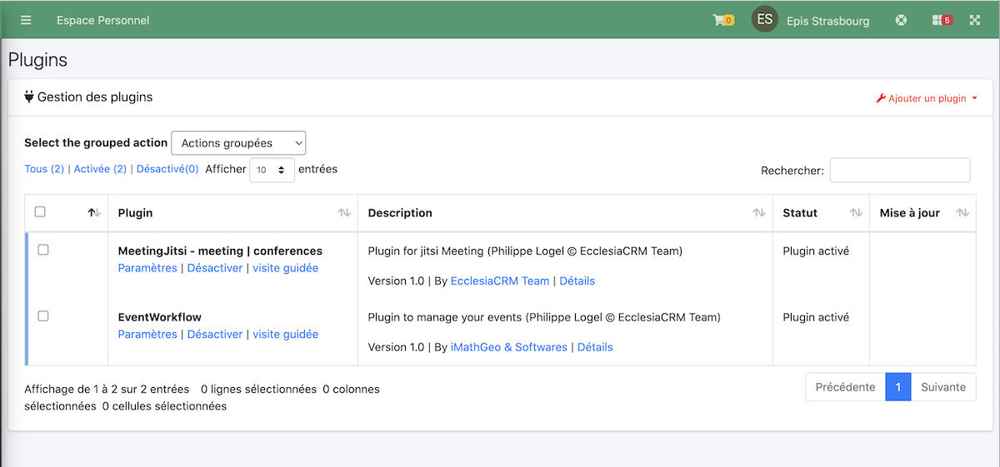
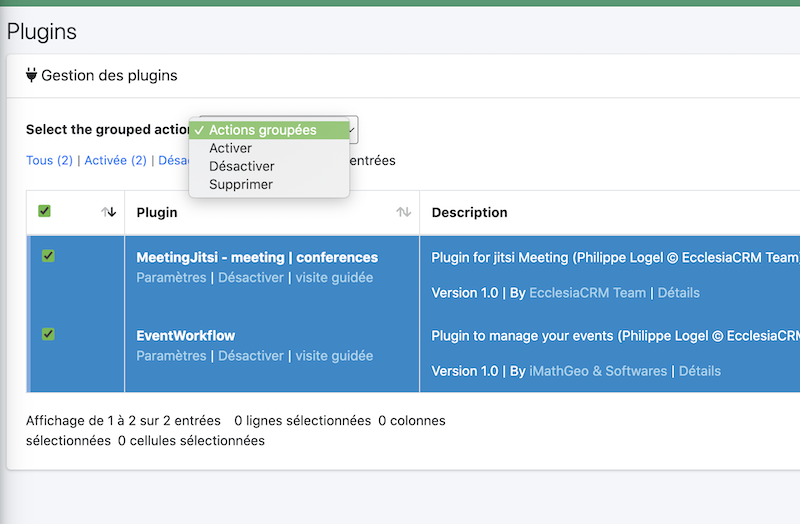
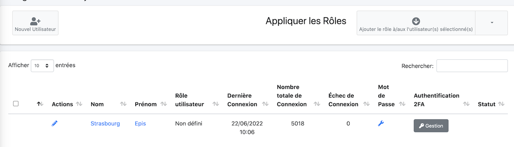
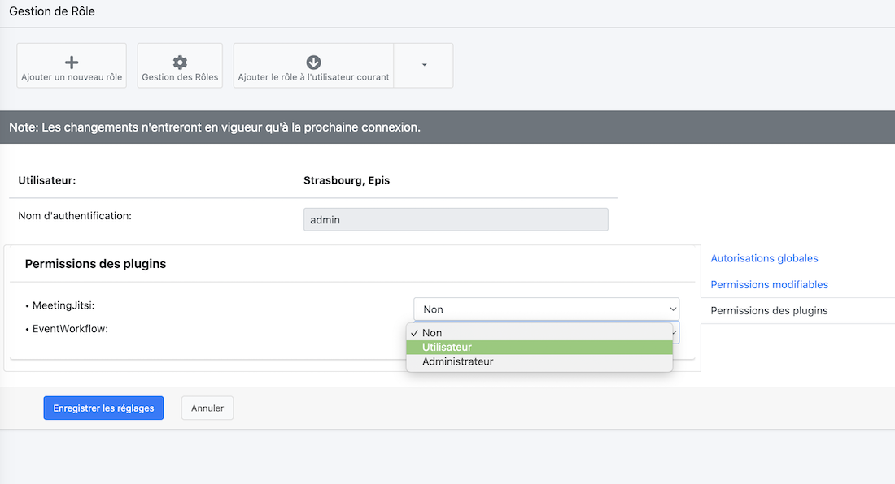

# Implementation

With the new version 8.0 of EcclesiaCRM, a new component in the administrator management is now available to you

To do so, you must have administrator rights

- go to the settings section on the top right

  

- You will have here the view to manage the plugins

  

  It is quite similar in its management to Wordpress.

- It is possible to add a plugin

  Screenshot](../../img/plugins/plugins-management-add.png)

  **Warning** this plugin must be validated at the level of a digital signature to be integrated into EcclesiaCRM.

- It is possible to activate or deactivate a plugin as a group or plugin by plugin.

  

- When an installed plugin's files are newer than its database version, the manager displays the available updates. Select the plugins to update: their migration scripts already on the server will run without uploading another archive.

  Back up the database first. If an update fails, processing stops and some changes may already have been applied; check the logs before retrying. A database version newer than the files or an invalid migration is reported without an automatic downgrade. The archive update button remains available.

# User rights management

Not all users have the right to access the plugin or want to access it.

To do so:
- Go to the settings for the users part

  Screenshot](../../img/plugins/plugins-management-users.png)

- We choose a user
  

- We get the new 8.0 management of EcclesiaCRM

  Screenshot](../../img/plugins/plugins-management-users2.png)

  You have to click the tab on the right: "Plugin permissions".

- We just have to activate or assign the rights :

  
