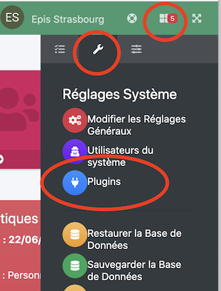
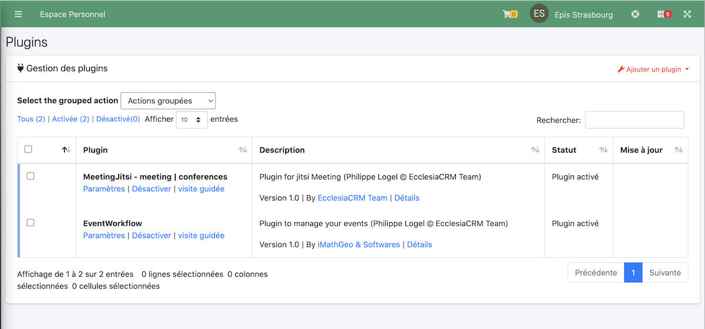
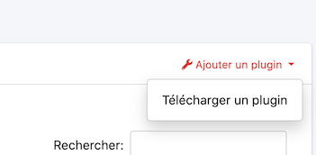
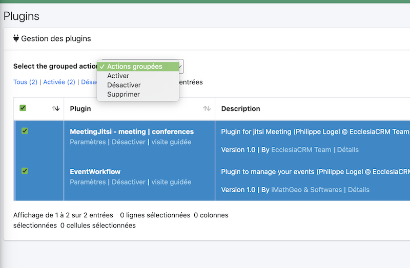
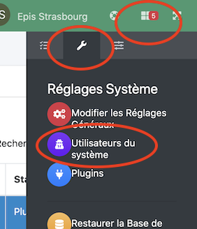
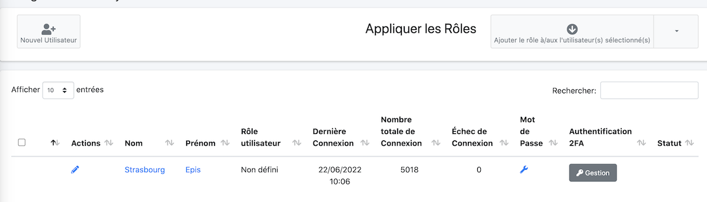
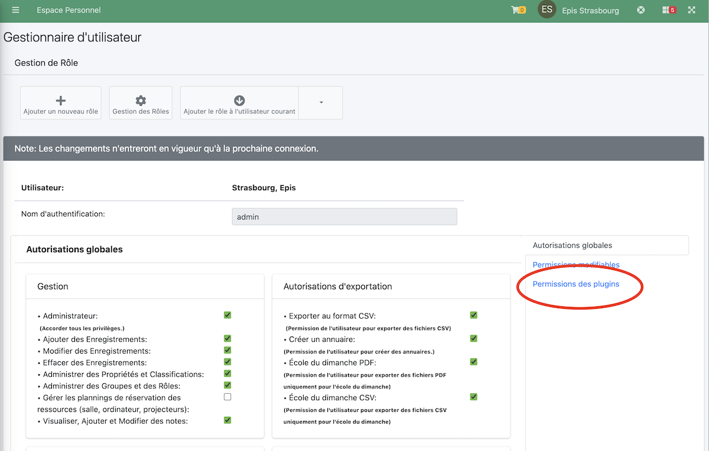
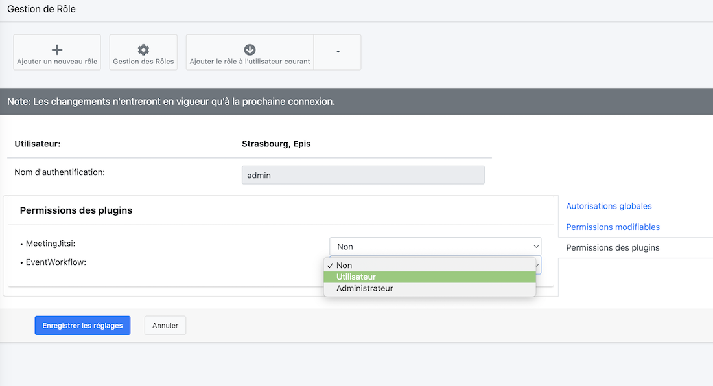

# Mise en place

Avec la nouvelle version 8.0 d'EcclesiaCRM, un nouveau volet dans la gestion administrateur est maintenant à votre disposition

Pour cela, il faut avoir des droits administrateurs

- aller dans la partie réglages en haut à droite

  

- Vous aurez ici la vue permettant de gérer les plugins

    

    Elle est assez similaire dans sa gestion à Wordpress.

- Il est possible d'ajouter un plugin

    

    **Attention** ce plugin doit être validé au niveau d'une signature numérique pour pouvoir être intégré à EcclesiaCRM.

- Il est possible d'activer ou de désactiver un plugin de manière groupée ou plugin par plugin.

    

- Lorsque les fichiers d'un plugin installé sont plus récents que sa version en base, le gestionnaire affiche les mises à jour disponibles. Sélectionnez les plugins à mettre à jour : leurs scripts de migration présents sur le serveur seront exécutés sans envoyer à nouveau d'archive.

  Sauvegardez la base de données avant de commencer. En cas d'échec, la mise à jour s'arrête et certaines modifications peuvent déjà avoir été appliquées ; consultez les journaux avant de réessayer. Une version en base plus récente que les fichiers ou une migration invalide est signalée sans rétrogradation automatique. Le bouton de mise à jour par archive reste disponible.

# Gestion des droits utilisateurs

Tous les utilisateurs n'ont pas forcément droit d'accéder au plugin ou ne veulent pas y accéder.

Pour cela :
- Aller dans les réglages pour la partie utilisateurs

    

- On choisit un utilisateur
  

- On tombe sur la nouvelle gestion 8.0 d'EcclesiaCRM

  

    Il faut cliquer l'onglet à droite : "Permissions des plugins"

- On n'a plus qu'à activer ou attribuer les droits :

  

